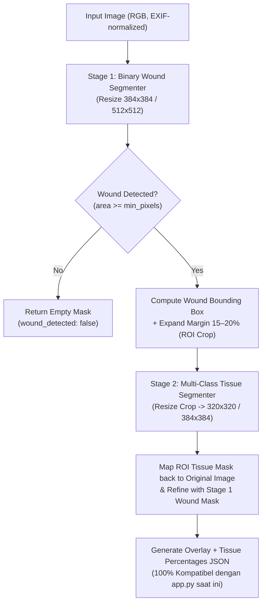

# WoundVision AI — V6 Two-Stage Architecture & Training Plan

> **Status**: Planning  
> **Baseline (Production)**: `V5-Augmented` (Single-Stage U-Net ResNet34, ONNX FP32 `93.22 MB`, CPU VPS ~`362 ms`, Peak RAM ~`272 MB`)  
> **Goal**: Meningkatkan akurasi deteksi area luka (**Wound Dice**) dan segmentasi jaringan klinis (**Clinical-3 Tissue Dice**) tanpa melampaui batas resource VPS (`768 MB` RAM limit, CPU-only) dan tanpa memecah kontrak REST API `/predict`.

---

## 1. Baseline & Target Performa

Seluruh evaluasi wajib dijalankan pada **30 gambar validasi `data/LUTSeg/val.txt`** (*patient-level split*, tidak pernah dilihat saat training) agar perbandingan antar versi 100% adil.

| Metrik | Baseline (`V5-Augmented`) | Target `V6` (Realistis — HF + LUTSeg) | Target Jangka Panjang (Data NakesPro 500–1k+) |
| :--- | :---: | :---: | :---: |
| **Wound Dice (Binary)** | `81.18%` | **`86% – 90%`** | `90% – 94%` |
| **Clinical-3 Macro Dice** *(Slough / Granulation / Necrotic)* | `59.45%` | **`65% – 70%`** | `75% – 85%` |
| **Macro Tissue Dice (5 kelas)** | `43.16%` | **`48% – 54%`** | `60% – 70%` |
| **Granulation Dice** | `74.89%` | `78% – 82%` | `85%+` |
| **Necrotic Dice** | `60.91%` | `65% – 70%` | `75%+` |
| **Slough Dice** | `42.54%` | `50% – 58%` | `70%+` |
| **False Positive pada Kulit Sehat** | Belum diuji | **< 5%** | **< 2%** |
| **VPS CPU Latency (2 threads)** | `~362 ms` | **`< 650 ms`** | `< 700 ms` |
| **Container Peak RAM** | `~272 MB` | **`< 480 MB`** | `< 550 MB` |

---

## 2. Arsitektur Two-Stage (Coarse-to-Fine)

Pada `V5`, satu model `320×320` dipaksa mengerjakan dua tugas sekaligus: mencari lokasi luka di seluruh foto sekaligus membedakan jaringan kecil (`Slough`, `Epithelial`) yang lebarnya sering < 15 piksel.

Di `V6`, tugas dipisah menjadi dua model ONNX yang ringan:

### Keunggulan Utama
1. **Resolusi Efektif Naik 3–5×**: Stage 2 menggunakan 100% piksel input khusus untuk melihat tekstur jaringan di dalam luka, bukan membuang ~84% piksel untuk background.
2. **Skalabilitas Data Terpisah**: Stage 1 bisa dilatih dengan ribuan gambar *binary mask* (yang jauh lebih mudah didapat), sementara Stage 2 fokus pada data *multi-class* berkualitas tinggi (`LUTSeg` + data teranotasi NakesPro nanti).
3. **Kontrak API Tidak Berubah**: `POST /predict` tetap mengembalikan JSON identik sehingga `salmanalfarisi.id/ai/woundvision` dan `app.nakespro.id` tidak perlu diubah.

---

## 3. Rencana Dataset & Kepatuhan Lisensi

> **Aturan Mutlak Anti-Leakage**:
> 1. 30 gambar di `data/LUTSeg/val.txt` **HARAM** masuk ke training Stage 1 maupun Stage 2.
> 2. **Jangan gunakan `CO2Wounds-V2`** karena sebagian pasiennya overlap dengan `LUTSeg` (berisiko mencemari `val.txt`) dan berlisensi `CC BY-NC 3.0`.
> 3. **Jangan campur dataset `NC` (Non-Commercial)** ke build produksi komersial `app.nakespro.id`.

### Jalur Dataset Stage 1 (Binary Wound Segmentation)
| Jalur | Sumber Dataset | Jumlah Gambar | Lisensi | Catatan |
| :--- | :--- | :---: | :--- | :--- |
| **Base (Wajib)** | `ksanchez84/LUTSeg` (`train.txt` + `Wound_Masks/`) | `111` | `CC BY 4.0` | Ambil hanya split `train.txt` |
| **Hard Negatives (Wajib)** | `rupeshsah/wound` (hanya `normal_*.png`) | `~100–200` | `Apache 2.0` | Mask seluruhnya `0` (background) agar tidak halusinasi di kulit sehat |
| **Track A — Eksperimen Cepat (HF)** | `praveen202/DFU_Datasets` (`external_fuseg` + `internal_dfuc2022`) | `500` | Mirror HF (`MIT`), sumber akademik FUSeg/DFUC | Total ~`711` gambar. Cocok untuk validasi konsep V6 / riset |
| **Track B — Produksi Komersial (`app.nakespro.id`)** | Mendeley `10.17632/hsj38fwnvr.2` (*Lower Limb & Feet Wound Dataset*) | `1.000+` | **`CC BY 4.0`** (resmi penulis asli) | Aman 100% untuk komersial dengan atribusi |

### Jalur Dataset Stage 2 (Multi-Class Tissue Segmentation)
| Sumber Dataset | Jumlah Gambar | Kelas | Lisensi |
| :--- | :---: | :--- | :--- |
| `ksanchez84/LUTSeg` (`train.txt` + `Masks/`) | `111` *(di-crop ROI + 5-fold CV)* | 6 kelas (`0..5`) | `CC BY 4.0` |
| *(Fase Berikutnya)* Data internal `app.nakespro.id` (anotasi konsensus nakes) | Target `300–1.000+` | 6 kelas (`0..5`) | Proprietary |

---

## 4. Desain Eksperimen Stage 1 (Binary Wound Detector)

### Spesifikasi Teknis
- **Task**: Binary segmentation (`1` output channel / sigmoid threshold `0.5`, atau 2-class softmax).
- **Input Size**: `384×384` *(uji juga `512×512` jika latency ONNX masih `< 250 ms`)*.
- **Kandidat Arsitektur (Ringan untuk ONNX CPU)**:
  1. `Unet` + `resnet34` *(baseline pembanding yang konsisten)*
  2. `Unet` + `efficientnet-b2` *(sangat ringan: ~35 MB ONNX, akurasi binary tinggi)*
  3. `FPN` atau `UnetPlusPlus` + `mit_b1` (SegFormer encoder — kuat di konteks global & batas luka)
- **Loss Function**: `0.5 * BCEWithLogitsLoss + 0.5 * BinaryDiceLoss` (atau `LovaszLoss` untuk batas lebih tajam).
- **Augmentasi**:
  - Geometri: `HorizontalFlip`, `VerticalFlip`, `RandomRotate90`, `ShiftScaleRotate` (scale ±20%, rotate ±30°), `RandomResizedCrop` ringan.
  - Fotometri: `RandomBrightnessContrast` (±20%), blur/noise kamera HP ringan.
- **Evaluasi & Kriteria Lulus Stage 1**:
  - Dievaluasi di `LUTSeg/val.txt` (binary ground truth: `mask > 0`) **dan** subset foto kulit normal (mengukur *False Positive Rate*).
  - **Target Lulus**: `Wound Dice >= 86.0%` pada `LUTSeg/val.txt` **dan** ONNX Stage 1 latency `< 250 ms` di VPS.

---

## 5. Desain Eksperimen Stage 2 (ROI Multi-Class Tissue Segmenter)

### Strategi ROI Crop Saat Training *(Kunci Keberhasilan!)*
Kesalahan umum pada two-stage adalah melatih Stage 2 hanya dengan *exact ground-truth bounding box*. Saat inference, Stage 1 tidak akan 100% presisi sehingga Stage 2 bisa gagal jika terlalu kaku.

**Solusi — Jittered ROI Cropping**:
1. Hitung bounding box dari ground-truth wound mask (`mask > 0`).
2. Tambahkan margin acak di setiap sisi sebesar **10% – 25%** selama training *(saat validasi/inference pakai margin tetap **18%**)*.
3. Tambahkan random shift pusat box sebesar **±8%** agar Stage 2 tetap tangguh terhadap ketidaksempurnaan crop Stage 1.
4. Pastikan crop tetap berbentuk **persegi (square padding / aspect-ratio preserving)** sebelum resize ke `320×320` (atau `384×384`) supaya bentuk jaringan tidak gepeng/terdistorsi.

### Spesifikasi Teknis Stage 2
- **Task**: 6-class semantic segmentation (`Background, Epithelial, Slough, Granulation, Necrotic, Other`) di dalam ROI crop.
- **Kandidat Arsitektur**:
  1. `Unet` + `resnet34` *(pretrained encoder dari Stage 1 atau ImageNet — uji keduanya!)*
  2. `Unet` + `convnext_tiny` atau `mit_b2` (lebih kuat menangkap tekstur halus Slough & Granulation)
- **Color-Preserving Augmentation *(Sangat Penting!)***:
  - **WAJIB HINDARI** `HueSaturationValue` / *hue shift* agresif karena warna merah/kuning/hitam adalah penanda utama *Granulation / Slough / Necrotic*.
  - Gunakan hanya: geometri (flip, rotasi 90°, affine ringan) + *brightness/contrast* ringan (±12%) + *gamma* ringan (0.9–1.1).
- **Loss Function**:
  - `Weighted Cross-Entropy / Focal Loss` + `Multi-Class Dice Loss` (atau `Focal-Tversky`) dengan penekanan kelas `Slough` dan `Necrotic` serta pengabaian kelas `Other` jika bobot mengganggu konvergensi.
- **Validasi**:
  - Gunakan **5-Fold Patient-Level Cross-Validation** pada `train.txt` untuk memilih hyperparameter & arsitektur terbaik tanpa overfitting ke `val.txt`.
  - Evaluasi final **end-to-end** (Input full image → Stage 1 ONNX → ROI Crop → Stage 2 ONNX → Paste-back ke full image) pada 30 gambar `LUTSeg/val.txt`.

### Kombinasi Output Stage 1 & Stage 2 (Ablation Wajib Diuji)
Bandingkan 2 mode penggabungan di validasi:
- **Mode A (Hard Masking)**: Prediksi Stage 2 di luar area Stage 1 dipaksa jadi `0 (Background)`.
- **Mode B (Soft Refinement)**: Stage 2 bebas memprediksi `Background` maupun jaringan di dalam ROI crop (berguna jika Stage 1 agak terlalu lebar).
Pilih mode yang menghasilkan `Wound Dice` + `Clinical-3 Dice` terbaik di `val.txt`.

---

## 6. Budget Resource Production (VPS Easypanel `768 MB` Limit)

| Komponen | Target Ukuran ONNX | Estimasi Peak RAM | Estimasi Latency VPS (2 threads) |
| :--- | :---: | :---: | :---: |
| Stage 1 (`efficientnet-b2` / `resnet34`) | `35 – 93 MB` | `~140 – 200 MB` | `~180 – 280 ms` |
| Stage 2 (`resnet34` / `convnext_tiny`) | `93 – 110 MB` | `~200 – 250 MB` | `~250 – 350 ms` |
| **Total Two-Stage Pipeline** | **`~130 – 200 MB`** | **`~380 – 480 MB`** | **`~450 – 630 ms`** |

- Kedua file ONNX di-host di Hugging Face Model Repo `salmanid/woundvision-ai` (mis. `stage1_wound_v6.onnx` dan `stage2_tissue_v6.onnx`).
- `inference.py` di-update agar memuat kedua session saat startup dengan `ORT_INTRA_THREADS=2` dan `ORT_INTER_THREADS=1`.
- Jika `stage1` mendeteksi tidak ada luka (`wound_pixels < threshold`), **Stage 2 langsung di-skip** → respon super cepat (`~200 ms`) dan 0 false-positive jaringan!

---

## 7. Roadmap Eksekusi Bertahap

### Phase 0 — Persiapan Data & Struktur Script (`Hari 1`)
- [ ] Download `Wound_Masks/` dari `ksanchez84/LUTSeg` (untuk Stage 1 binary).
- [ ] Buat script `scripts/download_stage1_datasets.py` untuk mengunduh:
  - `praveen202/DFU_Datasets` (Track A) atau Mendeley `CC BY 4.0` (Track B)
  - `normal_*.png` dari `rupeshsah/wound`
- [ ] Buat manifest terpisah `data/stage1_train.csv` (terverifikasi 0% overlap dengan `LUTSeg/val.txt`).
- [ ] Verifikasi visual 10 sample image+mask dari setiap sumber (pastikan konvensi mask `0/255` vs `0/1` seragam).

### Phase 1 — Training & Evaluasi Stage 1 (`Hari 2–3`)
- [ ] Buat modul `src/woundvision/stage1_train.py` & `stage1_eval.py`.
- [ ] Latih 2–3 kandidat encoder (`efficientnet-b2`, `resnet34`, `mit_b1`) di MPS/Colab.
- [ ] Evaluasi `Wound Dice` di `LUTSeg/val.txt` + *False Positive Rate* pada foto kulit normal.
- [ ] Pilih checkpoint Stage 1 terbaik (target `Wound Dice >= 86%`).

### Phase 2 — Training & Evaluasi Stage 2 ROI (`Hari 4–6`)
- [ ] Implementasikan `JitteredROICrop` dataset wrapper di `src/woundvision/roi_data.py`.
- [ ] Jalankan **5-fold patient-level CV** pada `LUTSeg/train.txt` (uji `resnet34` vs `convnext_tiny` / `mit_b2` + color-preserving augmentation).
- [ ] Evaluasi end-to-end **Stage 1 → Auto-Crop → Stage 2** pada `LUTSeg/val.txt` (uji Mode A vs Mode B).
- [ ] Lakukan *error analysis* pada 5 gambar val dengan skor terburuk (cek apakah error berasal dari crop Stage 1 atau klasifikasi Slough/Epithelial Stage 2).

### Phase 3 — ONNX Export, Benchmark & Kriteria Go/No-Go (`Hari 7`)
- [ ] Export Stage 1 & Stage 2 ke ONNX FP32 + verifikasi `100%` pixel parity vs PyTorch.
- [ ] Benchmark end-to-end latency & Peak RSS RAM lokal dan di Docker container dengan batas `768 MB`.
- [ ] **Go / No-Go Gate**: V6 **hanya** menggantikan `V5-Augmented` di production jika:
  - `Wound Dice > 85%` (vs `81.18%` di V5)
  - `Clinical-3 Macro Dice > 64%` (vs `59.45%` di V5)
  - Peak RAM container `< 550 MB` dan rata-rata latency `< 700 ms`

### Phase 4 — Rollout Production (`Hari 8`)
- [ ] Upload `stage1_wound_v6.onnx` & `stage2_tissue_v6.onnx` ke `salmanid/woundvision-ai` (HF Model Repo) + update Model Card & atribusi lisensi dataset baru.
- [ ] Update `inference.py` & `app.py` (`model_version: "V6-TwoStage"`), push ke GitHub `main`, redeploy di Easypanel.
- [ ] Verifikasi live `https://woundvision.salmanalfarisi.id/health` & `/predict` + cek performa di `salmanalfarisi.id/ai/woundvision`.
